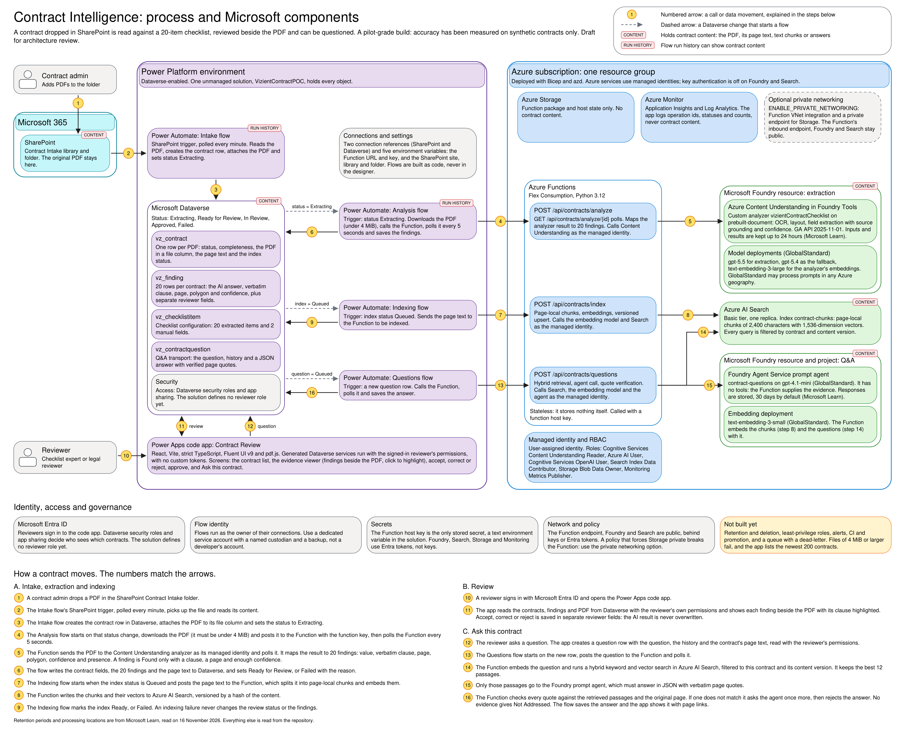

# Architecture

How Contract Intelligence is put together, for the people who will deploy, run and change it. The procedures are in the
[deployment runbook](./deployment-runbook.md) and the [operations runbook](./operations-runbook.md); the decisions are in the
[handoff guide](./handoff-guide.docx). This document describes what exists and why.

The diagram is [architecture/contract-intelligence-architecture.png](./architecture/contract-intelligence-architecture.png)
(about 4,000 px wide). The editable drawing is
[architecture/contract-intelligence-architecture.excalidraw](./architecture/contract-intelligence-architecture.excalidraw): open
it at <https://aka.ms/excalidraw>. A vector PDF of the same drawing is sent with the guide. The numbers on its arrows are the
steps in section 3. It is a draft for architecture review: nothing in it has been reviewed by an architect yet.

There is also an interactive 3D view of the review path, [architecture-3d.html](./architecture-3d.html): one web page that
plays a contract through eight steps, from the intake folder to a reviewer's decision, and opens in any browser from a
folder or a download with no sign-in and no network. It does not draw the Ask this contract path. It is the "How it works"
diagram of the Contract Review app, built into a single file, and it is not part of the Power Platform solution. SharePoint
Online downloads an HTML file from a document library instead of showing it ([Microsoft
Learn](https://learn.microsoft.com/sharepointmigration/migration-assessment-scan-browser-file-handling)), so share the file
itself, or put it on a static web host such as an Azure Storage static website.

> **Status.** This is a pilot-grade build. Accuracy has been measured on three synthetic contracts only, and the system has
> never been deployed from a clean start in a second tenant. Statements about Microsoft services come from Microsoft Learn,
> read on 16 November 2026; everything else was read from this repository.

## 1. Shape of the system

One document moves through three stages, and each stage is a separate piece that can be changed without the others.

| Stage | What runs | Where it runs |
|---|---|---|
| Intake | A SharePoint folder and the **Intake** flow | Microsoft 365, Power Platform |
| Extraction | The **Analysis** flow, an Azure Function and a Content Understanding analyzer | Power Platform, Azure |
| Review | A Power Apps **code app** reading Dataverse | Power Platform |
| Ask this contract (optional in design, not switchable today) | The **Indexing** and **Questions** flows, the same Function, Azure AI Search and a Foundry prompt agent | Power Platform, Azure |

Dataverse is the system of record. Everything that moves between stages is a row whose **status** changes; the flows are
triggered by those changes. There is no queue and no orchestrator beyond that.

## 2. Components

| Component | What it is | Notes |
|---|---|---|
| SharePoint intake folder | The library folder a person drops a PDF into | The original PDF stays here. Nothing in the project deletes it |
| Flow **Vizient Contract Intake** | Trigger: a file in the folder, polled every minute | Creates the `vz_contract` row, attaches the PDF to its file column, sets status Extracting |
| Flow **Vizient Contract Analysis** | Trigger: status becomes Extracting | Downloads the PDF, posts it to the Function, polls every 5 seconds, writes the contract fields, 20 findings and the page text, sets Ready for Review or Failed with the reason |
| Flow **Vizient Contract Indexing** | Trigger: index status becomes Queued | Posts the page text to the Function; marks the index Ready or Failed. A failure here never changes the review status or the findings |
| Flow **Vizient Contract Questions** | Trigger: a new question row | Posts the question to the Function, polls, saves the answer |
| Azure Function | Flex Consumption, Python 3.12, five HTTP routes (section 4) | Stateless: it stores nothing itself. Authenticates to Azure services as a user-assigned managed identity |
| Content Understanding analyzer | `vizientContractChecklist`, built from the checklist file, on the prebuilt document analyzer | OCR, layout and field extraction with source grounding and confidence, on the extraction models (section 5) |
| Foundry resource, extraction | Hosts Content Understanding and the extraction model deployments | Key (local) authentication is off |
| Foundry resource and project, Q&A | Hosts the prompt agent `contract-questions` and the embedding deployment | The agent has no tools: the Function supplies the evidence |
| Azure AI Search | Index `contract-chunks`: page-local chunks of 2,400 characters with 1,536-dimension vectors | Versioned by a hash of the document; every query is filtered to one contract and version |
| Power Apps code app | React, Vite, strict TypeScript, Fluent UI v9, pdf.js. Source in `contract-review/` | Uses generated Dataverse services with the signed-in reviewer's own permissions; no custom tokens |
| Dataverse solution | `VizientContractPOC`, unmanaged, publisher prefix `vz` | Holds every Power Platform object: tables, choices, relationships, flows, connection references, environment variables, the app |
| Storage, Application Insights, Log Analytics | Function package and host state; telemetry | The app logs operation ids, statuses and counts, never contract content |
| Optional private networking | `ENABLE_PRIVATE_NETWORKING=true` | Function VNet integration and a private endpoint for Storage. Foundry and Search stay public. Not deployed from scratch yet (deployment runbook, appendix E) |

The four tables, their relationships and the choice values are in [dataverse/schema.md](../dataverse/schema.md), and every
column is in [dataverse/schema.json](../dataverse/schema.json), the source of truth.

## 3. How a contract moves

**A. Intake, extraction and indexing**

1. A contract admin drops a PDF in the SharePoint folder.
2. The Intake flow's trigger picks it up and reads its content.
3. The flow creates the `vz_contract` row, attaches the PDF and sets the status to **Extracting**.
4. The Analysis flow starts on that change, downloads the PDF (it must be under 4 MiB) and posts it to the Function with the function
   key, then polls the Function every 5 seconds.
5. The Function sends the PDF to the analyzer as its managed identity and polls it. It maps the result to 20 findings: value,
   verbatim clause, page, polygon, confidence and presence. A finding is **Found** only with a clause, a page and enough confidence.
6. The flow writes the contract fields, the 20 findings and the page text to Dataverse and sets **Ready for Review**, or **Failed**
   with the reason.
7. The Indexing flow starts when `vz_indexstatus` is **Queued** and posts the page text to the Function, which splits it into
   page-local chunks and embeds them.
8. The Function writes the chunks and vectors to Azure AI Search, versioned by a hash of the content.
9. The flow marks the index **Ready** or **Failed**.

**B. Review**

10. A reviewer signs in with Microsoft Entra ID and opens the code app.
11. The app reads contracts, findings and the PDF from Dataverse with the reviewer's own permissions and shows each finding beside
    the PDF with its clause highlighted. Accept, correct or reject is saved in separate reviewer fields: the AI result is never
    overwritten.

**C. Ask this contract**

12. The reviewer asks a question. The app creates a question row with the question, the history and the contract's page text.
13. The Questions flow starts on the new row, posts the question to the Function and polls it.
14. The Function embeds the question and runs a hybrid keyword and vector search in Azure AI Search, filtered to this contract and
    version. It keeps the best 12 passages.
15. Only those passages go to the Foundry prompt agent, which must answer in JSON with verbatim page quotes.
16. The Function checks every quote against the retrieved passages and the original page. If one does not match it asks the agent
    once more, then rejects the answer. With no evidence the answer is Not Addressed. The flow saves the answer and the app shows
    it with page links.

**States.** Contract `vz_status`: Received, Extracting, Ready for Review, In Review, Approved, Failed. Index `vz_indexstatus`: Not
Indexed, Queued, Ready, Failed (independent of the review status). Question `vz_status`: Queued, Answered, Failed. **Extracting
doubles as the retry queue**: setting a Failed contract back to Extracting starts the Analysis flow again (operations runbook 3.1).

## 4. The Function's interface

All routes except `health` need a Function host key (`x-functions-key`). The flows hold it in the text environment variable
`vz_FunctionKey`.

| Route | Purpose | Notes |
|---|---|---|
| `GET /api/health` | Liveness | Anonymous. Static body, `{"status":"ok","service":"vizient-contract-api"}` |
| `POST /api/contracts/analyze` | Start an analysis | Body: `application/pdf` (with `?contractId=`), or JSON `{contractId, fileName, fileBase64}`. PDF only (checked), up to 32 MiB. Returns **202** with `Location` and `Retry-After: 5` |
| `GET /api/contracts/analyze/{operationId}` | Poll | **202** while running. **200** with `{contract, findings, raw, indexing}` when done. **502** for a failed analysis or an unexpected result, **404** if the operation expired |
| `POST /api/contracts/index` | Index page text | JSON with `contractId` and `context` (the page-numbered document). **400** `IndexRejected` or **502** `IndexUnavailable` on failure |
| `POST /api/contracts/questions` | Ask a question | JSON with `contractId`, `questionId`, `question` (up to 4,000 characters), `context` and `history`. Starts a background agent call and is called again until it is answered. **400** `QuestionRejected` or **502** `AgentUnavailable` on failure |

Errors have the form `{"error": {"code", "message"}}`. Content Understanding throttling returns **429** `Throttled` with
`Retry-After`. The handlers log operation ids, statuses and counts only. The source is `function/routes.py` and
`function/function_app.py`.

## 5. Models and services

| Use | Deployment | SKU |
|---|---|---|
| Extraction | `gpt-5.5`, with `gpt-5.4` as the fallback | GlobalStandard |
| The analyzer's embeddings | `text-embedding-3-large` | GlobalStandard |
| Q&A agent | `gpt-4.1-mini` | GlobalStandard |
| Q&A embeddings | `text-embedding-3-small` | GlobalStandard |

Content Understanding is on the GA API version 2025-11-01. All deployments are pay-per-token; a provisioned-throughput SKU is not
used. Deployment names equal model names so that Content Understanding's defaults map one to one (`infra/main.bicep`). Quota
needed for a backfill is in the [sizing workbook](./capacity-sizing-workbook.xlsx).

## 6. Identity and secrets

| Who | How they authenticate | What they can do |
|---|---|---|
| Reviewers | Microsoft Entra ID, through Power Apps | Whatever their Dataverse security role allows. **The solution defines no reviewer role yet**: that is an open item |
| The flows | The owner of each connection (SharePoint and Dataverse) | Flows run as that account. If its sign-in, license or consent changes, the flows stop. Use a dedicated service account with a named custodian and a backup |
| The Function | A user-assigned managed identity | Cognitive Services Content Understanding Reader, Azure AI User, Cognitive Services OpenAI User, Search Index Data Contributor, Storage Blob Data Owner, Monitoring Metrics Publisher, each on one resource (deployment runbook, appendix B) |
| The deployer | Their own Azure CLI sign-in | The template assigns data-plane roles to one user only (the account that ran `azd provision`) |
| The flows, calling the Function | The Function host key | **The only stored secret.** It sits in a plain-text environment variable inside the solution, so anyone who can read environment variable values can read it |

Foundry accounts, Search and Application Insights have local (key) authentication turned off. Rotating the Function key is
operations runbook 3.5.

## 7. Where contract content lives, and for how long

| Place | Holds | Retention |
|---|---|---|
| SharePoint, the intake library | The original PDF | Nothing in the project deletes it |
| Dataverse `vz_contract` | A copy of the PDF, the full page text, a reduced extraction result for debugging | Until a person deletes the row. Deleting a contract deletes its findings and questions, **but not its Search chunks** |
| Dataverse `vz_finding` | AI answers with clause, page, polygon and confidence, and reviewer decisions | As above |
| Dataverse `vz_contractquestion` | The question, the answer and its quotes. Context and history are cleared after an answer or a failure | As above |
| Azure AI Search | Page-local chunks and vectors | Until deleted. A re-analysis writes a new version, and old versions never expire (`scripts/purge-contract-index.py` removes them) |
| Power Automate run history | Action inputs and outputs. The flows secure the HTTP inputs and the indexing and question actions, but **not every output** in the Intake and Analysis flows, so document content can appear | The platform's retention period |
| **Content Understanding** | Input documents, intermediate results and results, in Microsoft-managed storage in the resource's region | **Up to 24 hours**, then deleted automatically (Microsoft Learn: Data, privacy, and security for Content Understanding) |
| **Foundry, Q&A responses** | Each question, its retrieved passages and the answer. The Function makes the agent call in the background (`background=True`), and Microsoft's Responses API requires `store=true` for that, so the response is stored | **30 days by default** in the Foundry resource (Microsoft Learn: "Use the Azure OpenAI Responses API"). A stored response can be deleted by id; **nothing in this repository deletes them** |
| Application Insights and Log Analytics | Operation ids, statuses and counts; never contract content | 30 days in the Log Analytics workspace |

**Processing location.** Every model deployment is GlobalStandard, so prompts may be processed in any Azure geography, although
data at rest stays in the resource's region. Whether that is acceptable for real contracts is decision A2 in the guide; a
data-zone SKU would change it, and that has not been tested with Content Understanding.

## 8. Rules the design enforces

- **Evidence or nothing.** A finding is **Found** only with a verbatim clause, a source page and sufficient confidence (the
  `HIGH_CONF` Function setting, default 0.80). Silence is **Not Addressed**; it is never treated as permission, and nothing is
  inferred from another document.
- **AI results are immutable.** Reviewer decisions go in separate reviewer fields, so accuracy can be measured. The cost is that
  re-extraction deletes findings, including reviewer decisions (operations runbook 3.3).
- **Extraction completeness is separate from review completion and from accuracy.** Do not read one as another.
- **Failing safe on size.** The Analysis flow refuses a file of 4 MiB or larger and marks the contract Failed, because the Dataverse
  connector's file download returns only the first 4 MiB and a cut-off PDF would turn missing pages into silent Not Addressed
  answers.
- **Quotes are verified.** The Q&A path accepts a quote only if it appears in the passages the Function retrieved and in the
  original page.
- **Everything is in the solution.** Dataverse objects are created only through the provisioning scripts, which send the solution
  header on every create; `scripts/verify-solution.py` fails if an object lands outside it.
- **Flows are code.** They are defined in `scripts/flowlib.py` and applied with `scripts/provision-flow.py`; editing them in the
  designer is overwritten the next time the script runs.
- **Synthetic contracts only in this repository.** Fixtures, gold labels and documentation use made-up contracts and numbers.

## 9. What is not built

Retention and deletion, least-privilege reviewer roles and a non-administrator test, alerts, a deployment pipeline and promotion between
environments (the repository's CI workflow builds and tests only), key storage beyond a text variable, a work queue with retries, reviewer
assignment, and paging past the newest 200 contracts. Operations runbook section 6 tracks them, and the guide's sections 6 and 7 say what
each costs at volume.

## 10. Where to change what

| To change | Edit | Then |
|---|---|---|
| The checklist | `checklist/checklist.json` | Rebuild the analyzer and the schema (operations runbook 3.6) |
| Extraction mapping or the Q&A path | `function/` | Run the tests, `azd deploy` |
| A table, column or choice | `dataverse/schema.json` | `provision-dataverse.py`, `verify-solution.py`, `pull-solution.py` |
| A flow | `scripts/flowlib.py` | `provision-flow.py --status`, then `--apply` |
| The app | `contract-review/src/` | Type-check, lint, test, build, then `pa app push` into the solution |
| The 3D architecture view (its text, parts or scene) | `contract-review/src/about/` | `npm run build:standalone` in `contract-review/` rebuilds `docs/architecture-3d.html`; a test fails while that page is older than its sources, or states a number the code no longer matches |
| Azure resources | `infra/` | `azd provision --preview`, read it, then provision |

More detail is in [Working in this repository](development.md), [Ask this contract](ask-this-contract.md) and operations runbook 3.10.
